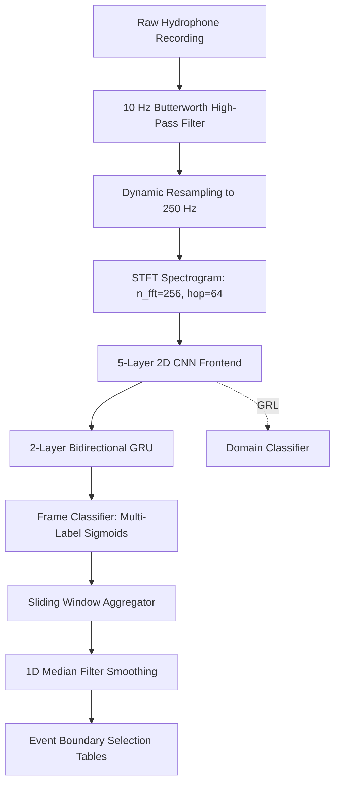

# 🐋 Baleen Whale Sound Event Detection (SED) Pipeline

[](https://www.python.org/)
[](https://pytorch.org/)
[](#)
[](https://dcase.community/)

An automated, GPU-accelerated **Sound Event Detection (SED)** pipeline designed to identify, classify, and temporally localize baleen whale vocalizations in Southern Ocean hydrophone recordings. Built for the Antarctic Blue & Fin Whale Acoustic Library challenge.

---

## 🌟 Key Features
*   **Streamlit Web Application**: An interactive, premium frontend UI for visualization, dynamic threshold tuning, and audio playback (`app.py`).
*   **Rational Resampling**: Handles sample rate discrepancies dynamically using high-performance C-based `soxr` resampling.
*   **Noise Minimization**: Integrates a 4th-order 10 Hz Butterworth high-pass filter to block hydrostatic pressure waves.
*   **CNN-RNN (CRNN) Architecture**: Combines a 5-layer 2D CNN (frequency-only pooling) with a Bidirectional GRU to model temporal sequence dependencies.
*   **Unsupervised Domain Adaptation (DANN)**: Employs a Gradient Reversal Layer (GRL) to align feature distributions between a source dataset and an unlabelled target dataset under domain shift.
*   **Advanced Training Techniques**: Supports Multi-Label Focal Loss for extreme class imbalance, Mixup Augmentation, and SpecAugment (time and frequency masking).
*   **Dynamic Threshold Optimization**: Sweeps a range of thresholds dynamically during validation to optimize class-specific thresholds for maximum F1-Score.
*   **Overlapping Detection Support**: Frame-level multi-label Sigmoid outputs allow classification of concurrent calls.
*   **Imbalance Resolution**: Vectorized silence gap-finding algorithms perform balanced negative training clip mining.
*   **Apple Silicon Acceleration**: Out-of-the-box support for Metal Performance Shaders (MPS) on Apple M-series chips.

---

## 🛠️ System Architecture



---

## 📂 Project Structure

```
whale-detection/
├── .vscode/               # VS Code execution & debug configurations
├── data/                  # Hydrophone recordings & Raven annotation files
│   ├── casey2014/         # Train Site: Casey (2014) recordings
│   └── Greenwich64S2015/  # Test Site: Greenwich (2015) recordings
├── models/                # Saved model checkpoint files (*.pth) and thresholds JSON
├── reports/               # Output predictions & assessment documents
│   ├── predictions/       # Extracted Raven-compatible selection files
│   └── technical_report.md# Formal engineering assessment report
├── src/                   # Python package modules
│   ├── __init__.py
│   ├── dataset.py         # Signal preprocessing, filtering, & balanced loader
│   ├── model.py           # Deep learning CRNN network & Domain Classifier (DANN/GRL)
│   ├── train.py           # Accelerated GPU training controller (DANN, dynamic thresholds)
│   ├── infer.py           # Overlapping sliding window boundary extractor
│   ├── evaluate.py        # Greedy IoU interval matcher
│   ├── losses.py          # Custom loss functions like Focal Loss
│   ├── export_onnx.py     # Script to export PyTorch model to ONNX
│   └── benchmark_onnx.py  # Latency comparison script for ONNX Runtime vs PyTorch
├── app.py                 # Interactive Streamlit Web Application
├── README.md              # Project documentation
├── approach.md            # Detailed methodology & design document
└── run_pipeline.sh        # Master Bash pipeline runner
```

---

## 🚀 Installation & Setup

### 1. Requirements
Ensure Python 3.11+ is installed. Clone the repository and install the standard scientific audio packages:

```bash
pip install numpy pandas scipy scikit-learn matplotlib librosa soundfile torch torchaudio pypdf streamlit onnxruntime
```

### 2. GPU Acceleration (macOS M-Series)
To run with hardware acceleration on Apple Silicon, resolve dynamic library links:

```bash
export DYLD_LIBRARY_PATH=/Library/Frameworks/Python.framework/Versions/3.11/lib/python3.11/site-packages/torch/lib
export PYTHONPATH=.
```

---

## ⚙️ Quick Start

### 1. Run the Streamlit Web App
To launch the interactive dashboard for running inferences, adjusting thresholds, and visualizing bounding boxes:

```bash
streamlit run app.py
```

### 2. Run the Entire Pipeline
To train, run inference, and generate the final F1 evaluation table end-to-end, execute the master script:

```bash
./run_pipeline.sh
```

### 3. Manual Testing (Step-by-Step)
You can run individual pipeline steps using Python's `-m` module switch:

*   **Step A: Train Model**
    ```bash
    python3 -m src.train --train_dir data/casey2014 --train_name casey2014 --val_dir data/Greenwich64S2015 --val_name Greenwich64S2015 --epochs 5 --subsample_train 0.05 --subsample_val 0.1 --save_path models/best_model.pth --loss_type focal --mixup_alpha 0.2 --spec_augment --dann
    ```

*   **Step B: Run Inference (Detection) on a WAV file**
    ```bash
    python3 -m src.infer --model_path models/best_model.pth --wav_path data/Greenwich64S2015/wav/20150102-140944.wav --output_dir reports/predictions/manual_test
    ```

*   **Step C: Evaluate Metrics against Ground-Truth**
    ```bash
    python3 -m src.evaluate --gt_dir data/Greenwich64S2015 --gt_name Greenwich64S2015 --pred_dir reports/predictions/manual_test --iou_thresh 0.1
    ```

*   **Step D: Export & Benchmark ONNX (Evidence of Speedup)**
    ```bash
    python3 -m src.export_onnx
    python3 -m src.benchmark_onnx
    ```

---

## 📊 Evaluation Metrics (Controlled Cross-Domain Held-Out Evaluation)

Evaluation was conducted on **57 strictly held-out recordings** (387 reference ground-truth events) from the Greenwich (2015) deployment using bipartite Hungarian matching (IoU $\ge 0.1$):

| Class Name | Target Val GT | Frozen Threshold (CRNN / DANN) | Calibration Status | Test GT | CRNN Baseline F1 | CRNN DANN F1 | Mean Paired Diff (DANN - CRNN) | Paired 95% Bootstrap CI |
| :--- | :---: | :---: | :--- | :---: | :---: | :---: | :---: | :---: |
| **`Bm.Ant-A`** | 191 | 0.05 / 0.15 | `calibrated_event_f1` | 246 | 0.0000 | **0.1109** | +0.1100 | [+0.0761, +0.1492] |
| **`Bm.Ant-B`** | 28 | 0.05 / 0.05 | `calibrated_event_f1` | 44 | 0.0000 | 0.0000 | +0.0000 | [+0.0000, +0.0000] |
| **`Bm.Ant-Z`** | 6 | 0.15 / 0.05 | `calibrated_event_f1` | 9 | **0.0128** | 0.0000 | -0.0127 | [-0.0264, -0.0025] |
| **`Bm.D`** | 4 | 0.50 / 0.50 | `uncalibrated_no_validation_detection` | 14 | 0.0000 | 0.0000 | +0.0000 | [+0.0000, +0.0000] |
| **`Bp.20Hz`** | 0 | 0.50 / 0.50 | `uncalibrated_no_positive_events` | 1 | 0.0000 | 0.0000 | +0.0000 | [+0.0000, +0.0000] |
| **`Bp.20Plus`** | 0 | 0.50 / 0.50 | `uncalibrated_no_positive_events` | 1 | 0.0000 | 0.0000 | +0.0000 | [+0.0000, +0.0000] |
| **`Bp.Downsweep`** | 14 | 0.05 / 0.05 | `calibrated_event_f1` | 13 | 0.0000 | 0.0000 | +0.0000 | [+0.0000, +0.0000] |
| **`Unidentified`** | 62 | 0.05 / 0.05 | `calibrated_event_f1` | 59 | 0.0517 | 0.0517 | +0.0000 | [+0.0000, +0.0000] |
| **Macro-F1 (IoU $\ge$ 0.1)** | — | — | — | **387** | **0.0081** | **0.0203** | **+0.0122** | **[+0.0075, +0.0174]** |
| **Micro-F1 (IoU $\ge$ 0.1)** | — | — | — | **387** | **0.0120** | **0.0969** | **+0.0841** | **[+0.0537, +0.1193]** |
| **False Positives / Hour** | — | — | — | — | **97.86** | **163.41** | **+65.46** | **[+47.72, +85.17]** |

> [!NOTE]
> **Key Scientific Takeaways & Protocol Audit**:
> * **Recording-Level Split Isolation**: Disjoint recording-level subsets (`data/splits/`) prevent data leakage between source training (`source_train.csv`), source validation (`source_val.csv`), target adaptation (`target_adaptation.csv`, 95 unlabelled recordings), target validation (`target_val.csv`, 38 recordings), and held-out target testing (`target_test.csv`, 57 recordings).
> * **Explicit Calibration Statuses**: Thresholds were calibrated on `target_val.csv` using Hungarian matching. Classes without validation support (`Bp.20Hz`, `Bp.20Plus`) were marked `uncalibrated_no_positive_events`, while `Bm.D` was marked `uncalibrated_no_validation_detection`. Their fallback 0.50 thresholds yielded 0 predictions under model output floors, properly penalizing all reference test events as false negatives.
> * **Paired Bootstrap Verification**: A paired recording-level bootstrap over 2,000 resamples confirms a positive difference in Macro-F1 ($\Delta = +0.0122$, empirical 95% CI: $[+0.0075, +0.0174]$) and Micro-F1 ($\Delta = +0.0841$), driven by Antarctic Blue Whale `Bm.Ant-A` ($TP = 96$ vs. $0$).
> * **False Alarm Tradeoff & Generalization Scope**: DANN's increased sensitivity comes at a significant false-alarm cost (+65.46 false positives/hour; 95% CI: $[+47.72, +85.17]$). The evaluation tests within-site temporal generalization under domain shift on held-out Greenwich 2015 recordings; generalization to independent geographic sites remains unverified.

---

## 📝 Documentations
*   **Methodology Details**: See [approach.md](file:///Users/sanketshakya/Desktop/whale-detection/approach.md) for signal designs and mathematical rationale.
*   **Formal Report**: See [reports/technical_report.md](file:///Users/sanketshakya/Desktop/whale-detection/reports/technical_report.md) for full experiments, failures, and scaling plans.
